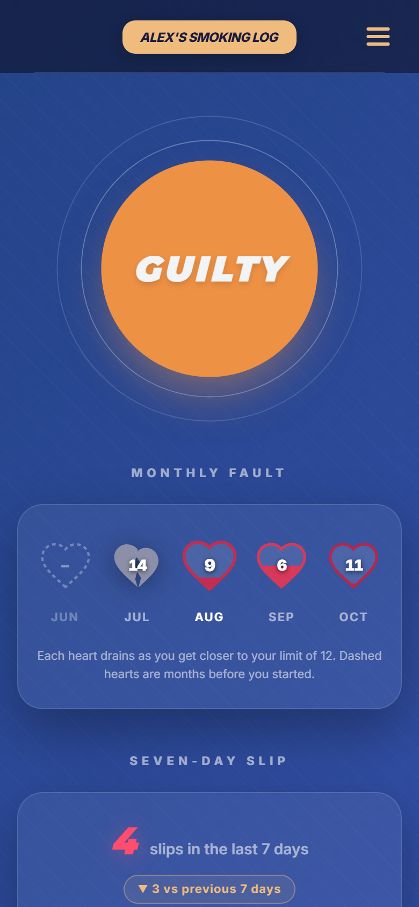
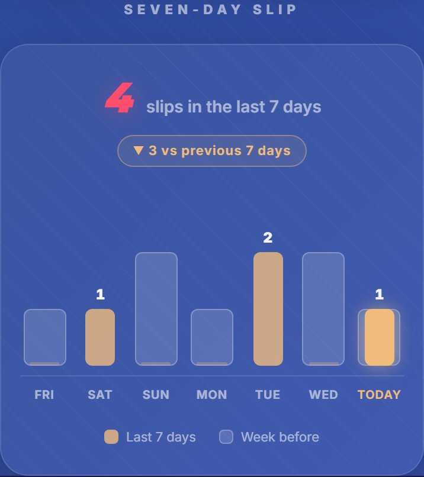
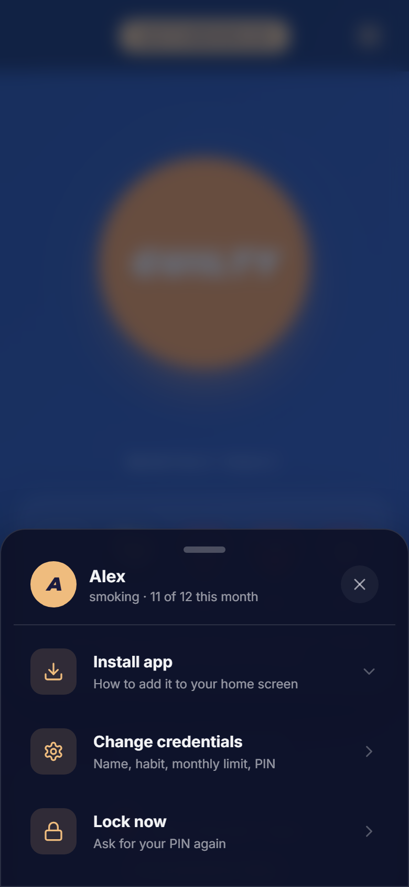

<div align="center">


# How many times I have done it

**A private, one-tap tracker for the habit you're trying to cut down on.**

Smoking, drinking, junk food, doom-scrolling: whatever it is, tap one button each time it happens and see honestly how you're doing.

### [▶ Open the app](https://mogdho.github.io/how-many-time/)

No sign-up · No servers · Works offline · Installs like a normal app

</div>

---

<p align="center">
  
  &nbsp;
  
  &nbsp;
  
</p>

## How it works

1. **Set it up once.** Enter your name, the habit you're tracking, a **monthly limit**, and a 4-digit PIN.
2. **Tap GUILTY** every time you slip. Your phone gives a short buzz to confirm it.
   Tapped by mistake? Hit **Undo** within 10 seconds.
3. **Watch your progress.**
   - **Monthly hearts:** each month gets a heart that **drains** as you get closer to your limit. Go over the limit and it turns into a grey **broken heart**. Dashed hearts are months before you started.
   - **Seven-day slip:** your total for the last 7 days, whether that's **better ▼ or worse ▲** than the 7 days before, and a bar for each day (the faint bar behind it is the same day a week earlier).

## Your data stays yours

- **Everything is stored on your device only**, in your browser's own storage. Nothing is uploaded, there's no account, and there's no tracking or analytics.
- **PIN lock:** the app asks for your PIN every time you open it. Use **Lock now** in the menu to lock it straight away.
- **Wipe protection:** after 7 wrong PINs you get a warning, and on the **10th wrong attempt all data is erased**.
- **Panic wipe:** one button at the bottom of the screen erases everything immediately (it asks you to confirm first).

> **Good to know:** because nothing is stored online, there's no backup or sync. Clearing your browser's site data, or using a different phone or browser, starts you fresh.

## Install it on your phone

The app works in any browser, but installing it puts it on your home screen, opens it full-screen, and lets it work with no internet.

| Device | How |
|---|---|
| **Android** (Chrome, Edge) | Open the app → **☰ menu → Install app**. Or use the browser menu → *Install app*. |
| **iPhone / iPad** (Safari) | Tap **Share** → **Add to Home Screen**. |
| **Computer** (Chrome, Edge) | Click the install icon in the address bar, or **☰ menu → Install app**. |

Updates arrive automatically the next time you open the app.

---

## For developers

Built with **React 18**, **Vite 8**, **Tailwind CSS 4**, **Framer Motion**, **IndexedDB** (via `idb`) and **vite-plugin-pwa**.

```bash
npm install
npm run dev      # start a local dev server
npm run build    # production build into dist/
npm run preview  # serve the production build locally (PWA features work here)
```

**Deploying:** every push to `main` runs [`.github/workflows/deploy.yml`](.github/workflows/deploy.yml). It builds the app and publishes `dist/` to the `gh-pages` branch, which GitHub Pages serves at <https://mogdho.github.io/how-many-time/>.

**Where things live**

| Path | What it is |
|---|---|
| `src/index.css` | Color palette and fonts. Use these tokens (`bg-peach`, `text-brand`, `border-crimson`…) rather than raw hex colors. |
| `src/App.css` | Shared component styles: `.btn`, `.glass`, `.panel`, form fields. |
| `src/components/Dashboard.jsx` | Main screen: GUILTY button, undo, settings. |
| `src/components/WeeklyChart.jsx` | Monthly hearts and the seven-day chart. |
| `src/components/MenuSheet.jsx` | The bottom-sheet menu. |
| `src/components/DialogProvider.jsx` | Themed `alert`/`confirm` dialogs. Use `useDialog()` instead of the browser's `alert()`/`confirm()`. |
| `src/lib/db.js` | Local storage (IndexedDB) for logs and the user profile. |
| `src/lib/pwa.js` | Install prompt, offline-ready and update handling. |
